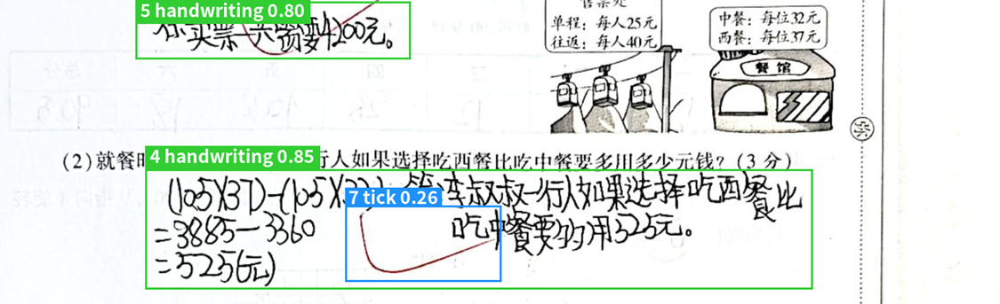

# 2026 神经网络与深度学习课程设计

## 项目概述

### 项目简介

“纸上得来终觉浅，绝知此事要躬行。”通过前期的课程作业，同学们已经初步掌握了深度学习的基本原理及相关框架的使用方法。然而，已有作业与实际开发和科研实践仍存在一定差距。为了进一步巩固所学知识，提升同学们的实践能力，本次课程设计将以目标检测为主题，要求同学们从数据标注入手，完成**启辰**和**勤思**两个数据集的目标检测模型训练。课程设计采用小组合作的形式开展，每组 **2** 人。其中，数据标注工作由每位同学独立完成，其余环节则由小组成员协作完成。

最终的考核形式以**答辩**为主。同学们需要以个人为单位撰写并提交 (a) 实验报告和 (b) 人工智能使用说明，以组为单位提交 (a) 实验代码和 (b) 答辩 PPT。

相关代码请参阅 GitHub 仓库：[caixd-220529/deel_learning_2026-public](https://github.com/caixd-220529/deel_learning_2026-public)

### 问题定义

[目标检测（Object Detection）](https://www.ultralytics.com/glossary/object-detection?utm_source=chatgpt.com)是一项旨在识别图像或视频流中物体的位置和类别的任务。[目标检测器（Object Detector）](https://academy.ultralytics.com/courses/computer-vision-foundations/object-detection/object-detection?utm_source=chatgpt.com)的输出是一组包围图像中物体的[边界框（Bounding Boxes）](https://www.ultralytics.com/glossary/bounding-box?utm_source=chatgpt.com)，同时还包含每个边界框对应的类别标签和置信度分数。

在本课程设计中，我们需要通过训练目标检测器，识别图片中指定类型的目标区域。如下图所示，模型通过输出边界框，标识出图片中手写文字和批改符号所在的位置，并为每个边界框分配相应的类别标签及置信度分数。其中，边界框用于确定目标区域的位置和范围，类别标签用于区分不同类型的目标，置信度分数则表示模型对预测结果的置信程度。



### 评价指标

本次课程设计将采用模型在测试集上的 mAP50-95 作为模型性能的评价指标，并以模型在勤思和启辰两个测试集上的 mAP50-95 平均值作为最终排名依据。

### 完成内容

后面的章节会进行详细介绍，此处进行简要概述。

- 步骤一：熟悉并使用 labelImg 软件提取公式图片。本次实验会提供真实的**试卷**（启辰数据集）以及**船舶监控截图**（勤思数据集）作为数据源给每位同学，每位同学负责其中一部分图片的目标框选。
- 步骤二：下载获取数据集。
- 步骤三：安装实验需要的虚拟环境。
- 步骤四：进行数据预处理和数据增强。
- 步骤五：训练目标检测模型。
- 步骤六：提交模型测试集预测结果，获取测试集成绩。
- 步骤七：提交实验报告，准备答辩。

### 评分标准

本课程设计的总分值为 100 分：

1. 数据标注（40分）：**高质量完成**对应标注任务即可得到该部分分数的 85%，**额外标注一份**即可得到得到该部分分数的 100%。注：若标注质量低则酌情扣分。
2. 模型实现（50分，**结合答辩环节评估**）：

   - 模型正确性（30分）：评分根据参考代码实现是否正确、实验结果评测指标、代码可复现性和注释等方面来考虑。
   - 模型拓展性（20分）：优化模型、优化数据增强流程、讨论任务瓶颈等。
3. 实验报告（10分）：材料完整性，命名规范性，书写美观性等等。

注意事项：

- **严禁抄袭或伪造。** 若发现代码、模型、实验结果或实验报告存在抄袭、伪造等学术不端行为，将扣除相应部分的分数。
- **实验报告并非越长越好。** 直接使用 AI 生成冗长、详细的实验报告，往往难以突出同学们在课程设计中的实际工作与创新之处。请同学们如实声明在本次课程设计中使用生成式人工智能工具的具体情况。对于实验报告，可以以章节为单位进行说明，例如哪些章节由自己独立完成、哪些章节使用 AI 辅助润色、哪些章节完全由 AI 生成，以便助教有针对性地阅读和评估。我们不会因使用 AI 工具而扣分。
- **严禁使用 AI 生成或伪造实验结果。** 

## 步骤一：标注数据

本次课程设计使用的标注软件为 labelImg，请同学们参阅 [labelImg.md](labelImg.md) 安装软件，参阅 [qichen_rule.md](qichen_rule.md) 了解启辰数据集的标注规则，参阅 [qinsi_rule.md](qinsi_rule.md) 了解勤思数据集的标注规则。

数据集的获取方式、标注结果的提交方式、标注结果的格式、提交截止日期，同样参阅参阅 [labelImg.md](labelImg.md).

## 步骤二：获取数据集

数据集将会被上传到 QQ 群，由于数据集未正式公开，目前仅用作课程作业，**请勿传播**。对于每个数据集，同学们可以拿到训练集的图片和标签，以及测试集的图片。

格式和说明如下：

```
datasets/
├── qichen/                         # 启辰数据集
│   ├── images/
│   │   ├── train/                  # 训练集图片
│   │   └── val/                    # 测试集图片（虽然叫 val）
│   ├── labels/
│   │   └── train/                  # 训练集 YOLO 标签
│   ├── class.txt                   # 类别编号与名称对照表
│   └── handwriting.yaml            # YOLO 数据配置文件
│
└── qinsi/                          # 勤思数据集
    ├── images/
    │   ├── train/                  # 训练集图片
    │   └── val/                    # 测试集图片（虽然叫 val）
    ├── labels/
    │   └── train/                  # 训练集 YOLO 标签
    ├── class.txt                   # 类别编号与名称对照表
    └── absence.yaml                # YOLO 数据配置文件
```

请同学们自行划分 `train` 文件夹的数据，用作模型训练的训练集和验证集。最终提交的结果为 `val` 图片对应的标签。

## 步骤三：安装虚拟环境

推荐使用 [Anaconda](https://www.anaconda.com/download) 管理虚拟环境：

```bash
conda create -n deep_learning_2026 python=3.12
conda activate deep_learning_2026
bash shell/v0807/install_verl.sh
bash shell/v0807/install_yolo.sh
```

## 步骤四：数据预处理与数据增强

本次课程设计提供的数据集可以直接用于模型训练，无需额外进行数据预处理。

为了进一步提升模型的检测性能，同学们可以尝试通过**数据增强**来丰富训练样本。数据增强为本次课程设计的可选环节。由于勤思数据集相对简单，即使直接使用原始数据进行训练，也能够取得较好的检测效果。因此，建议同学们重点探索启辰数据集上的数据增强方法。

具体而言，启辰数据集中的勾叉目标数量相对较少，同学们可以尝试自行在白纸上绘制勾叉，然后通过代码或 Photoshop 等工具提取勾叉图案，制作成透明背景的图片。随后，将这些勾叉随机渲染到训练集的图片中，并同步更新图片对应的标签，以增加训练集中勾叉目标的数量。

需要注意的是，验证集中的图片应保持原始状态，不应该包含人工渲染的勾叉，从而确保验证结果能够可靠反映模型在测试集上的实际性能。

## 步骤五：训练模型

同学们可以使用本项目 `src/object_detection/yolo_training.py`，进行模型的训练。`ultralytics` 库在训练过程中会提供详细的训练指标，例如精确率，召回率，mAP50，以及mAP50-95

## 步骤六：提交推理结果与打榜

本次课程设计不强制要求同学们提交测试结果，但是否提交测试结果以及最终测试成绩均会作为课程设计评分的参考依据。

同学们可以使用本项目提供的 `src/object_detection/yolo_inference.py` 脚本，生成模型在测试集上的推理结果。对于使用其他目标检测模型的同学，提交文件的格式**必须**与 `yolo_inference.py` 的输出格式保持一致，否则将无法正常参与打榜排名。

具体的测试结果提交方式及相关要求，请参阅 [submit_label.md](https://chatgpt.com/g/g-p-6a851139bd848191a3217d0e0c330333-deep-learning-2026/c/submit_label.md)。

## 步骤七：准备答辩和提交材料

### 答辩

- 日期：11 月 29 日（周日上午）
- 时间：8:30 ~ 12:30
- 地点：线下（待定）
- 时长：5 分钟PPT + 3~5 分钟提问
- 准备：PPT，实验报告，源代码等辅助材料

### 提交材料

1. 同学们需要以组为单位提交 ZIP 压缩包，包含以下文件/文件夹：
   - `序号-班级-学号-姓名.docx`：实验报告。如果某组的同学大于 1 名，则应该包含所有同学的实验报告。其中，`班级` 必须与 `华南理工大学教学班点名册` 中的名称完全一致。其余字段参阅第 2 点的说明。
   - `序号-班级-学号-姓名-人工智能使用说明.docx`：用于说明本次课程设计中人工智能工具的使用情况，包括使用 ChatGPT、DeepSeek 等大语言模型，以及 Codex、DeepSeek Harness 等 AI Agent 工具辅助完成的具体环节与工作内容。
   - `src/`：文件夹下存放本次实验的源代码。请不要在源代码文件夹下放置模型权重、虚拟环境、图片。
   - `答辩.pptx`：答辩使用的 PPT。
2. 压缩包应为 `序号1-学号1-姓名1-序号2-学号2-姓名2-course_design_report-v版本号.后缀`。如果以个人为单位提交，则压缩包的命名应该为 `序号-学号-姓名-course_design_report-v版本号.后缀`。其中：
   - `序号` 为 `华南理工大学教学班点名册` 中对应列的值。
   - `学号` 必须是 12 位。
   - `版本号` 必须是大于 0 的有效十进制整数，前面加字母 `v`，例如 `v1` 或 `v2`。
   - `后缀` 只能是 `zip`，不要重复添加后缀，例如 `xxx.zip.zip`。
   - 命名示例：`1-202330459999-张三-2-202330451145-李四-course_design_report-v1.zip`。
3. 如需重新提交，请依次递增版本号（如 `v2`、`v3`）。每位同学最多可提交 3 个版本，最终以最后提交的版本为准。
4. 文件名不符合上述格式或超过截止时间提交的文件，均不予接收。截止时间为 **2026 年 11 月 26 日 23:59**。
5. 请通过 `http://222.201.139.67:8080/files/course_design_report_submission/` 提交文件，登录用户名为 `student`，密码为 `scut123456`。不接受通过 QQ 等其他方式提交。注意：`student` 用户的密码与提交课程作业时使用的密码不同。
6. 提交前，请检查实验报告的排版，确保格式整洁、便于批阅，并核对压缩包中的文件是否符合提交要求。实验报告的排版质量及提交文件是否符合要求，均可能影响本次作业的成绩。
7. 压缩包大小不得超过 **10 MB**，超出限制的文件将被自动删除。如有特殊情况，请联系助教。
