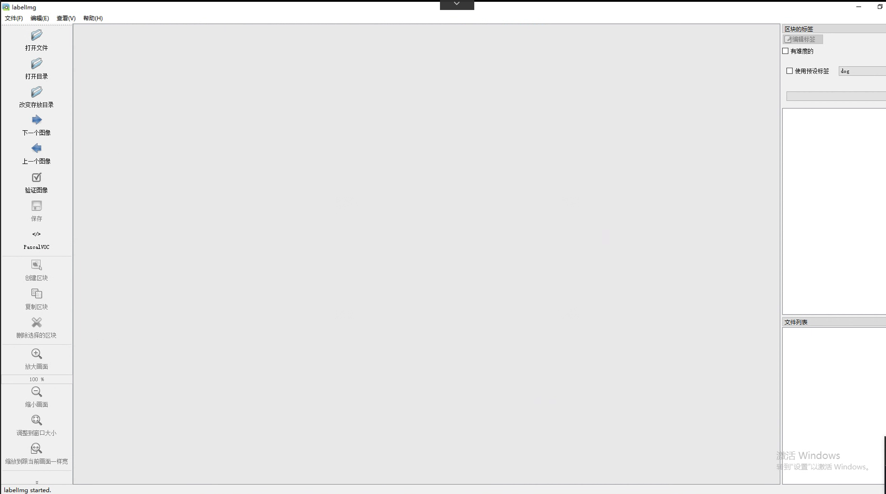
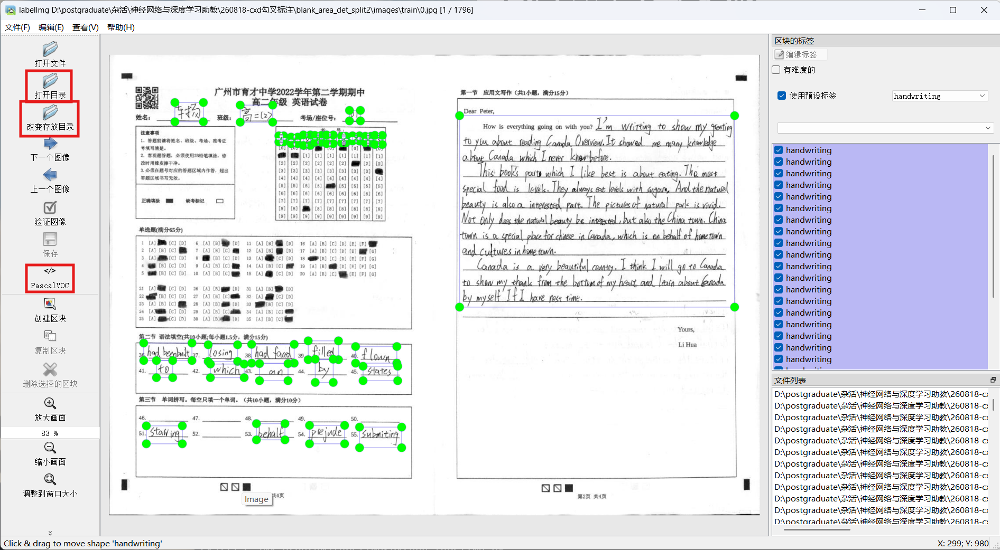
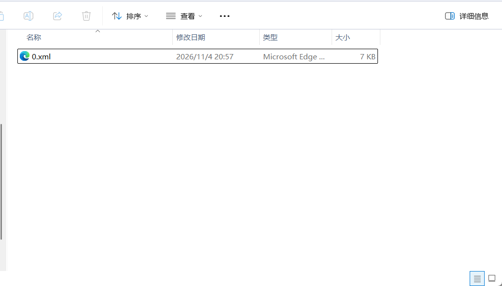

# labelImg 使用说明

## 使用软件介绍

本次标注使用的是 labelImg，是目标检查与识别科研界内广泛使用的开源标注软件。项目地址为：https://github.com/tzutalin/labelImg

## 软件安装流程

1. 在windows系统下运行。首先下载仓库文件到本地，可以*手动下载zip压缩包后解压*或者*在目标路径下打开git bash并输入以下命令*
    ```shell
    git clone https://github.com/heartexlabs/labelImg.git
    ```

    > TIP: 什么，你还没装过 git？快问问 GPT "How to install git on Windows and add it to system path?"
    > 
    > 当然，建议有经验的同学指导萌新通过包管理器 [chocolatey](https://chocolatey.org/) 或者 [Scoop](https://scoop.sh/) 安装
2. 安装 `make`。make 用于执行 Makefile，假如用过 C/C++ 的编译应该并不陌生。安装方式参考[这里](./assets/make.html)，只需要做到 "How to Create a Makefile in Windows?" 之前

3. 记得激活你想要的 Python 虚拟环境。例如要激活用 Anaconda 安装的虚拟环境 (e.g., my_env) 的话:

    ```shell
    conda activate my_env
    ```
4. 进入 labelImg 文件夹，打开 PowerShell 或 cmd，按行依次运行
    ```shell
    pip install pyqt5 lxml
    make qt5py3
    python labelImg.py
    ```

    > TIP: 在文件管理器的地址栏里输入 `cmd` 后回车可以直接在当前文件夹打开 cmd（Windows Terminal 则是 `wt -d .`）

顺利执行 `labelImg.py` 后将自动打开标注软件如下图：



## 标注流程

数据标注属于最基础且重要的工作，在真实的生产环境中，提高数据的质量往往比提高算法更加有效，因此企业常常花费大量的时间和经历做一些数据相关的工作。以下标注流程以启辰数据集为例子说明。

1. 新建文件夹用于存放标注图片和对应的标签

    在自定义的路径下新建 `input_images` 和 `output_annotations` 两个空文件夹。把所分配的数学试题图片放入 `input_images` 中。`output_annotations` 文件夹用于存放后续软件生成的每张图片的xml标签。**待标注完成后重命名并提交 `output_annotations` 文件夹压缩包**

2. 在网址 `http://222.201.139.67:8080/files/image_distribution/` (用户名 `downloader`，密码 `scut123456`) 下找到自己 `点名册序号.zip` 的压缩包下载（如点名册序号为 1 号则下载文件夹 `1.zip`）。

3. 修改类别标签文件 `labelImg/data/predefined_classes.txt`，删去原来类别名称，输入任务指定类别（`handwriting, tick, cross`）后，保存退出。

4. 在 labelImg 的文件夹下，使用命令 `python labelImg.py` 打开标注软件

5. 点击打开目录 (<kbd>Open Dir</kbd>)，选择 `qichen` 文件夹

6. 点击改变存放目录 (<kbd>Change Save Dir</kbd>)，选择 `qichen_labels` 文件夹

7. 点击 <kbd>Yolo/Pascal</kbd> 切换到 <kbd>PascalVOC</kbd> 模式。

    

8. 点击创建区块（快捷键 <kbd>w</kbd>），圈出图片中的手写体区域，选择标签选择 handwriting，按“<kbd>OK</kbd>”键完成一个框的标注。当完成当前图片所有框选后，使用快捷键 <kbd>ctrl</kbd>+<kbd>S</kbd> 保存，当前图片的标注将自动保存到 `qichen_labels` 文件夹下。之后点击下一张图片（下一张图片快捷键 <kbd>d</kbd>，上一张图片快捷键 <kbd>a</kbd>），重复以上过程直到完成预定数量的标注。

   > TIP: 检查 `qichen_labels` 文件下是否生成同名的xml标注文件。

   

## 提交说明

> **请务必提交指定格式的文件。不按格式提交的文件可能无法正常评分❗❗❗**
> 
> **请务必提交指定格式的文件。不按格式提交的文件可能无法正常评分❗❗❗**
> 
> **请务必提交指定格式的文件。不按格式提交的文件可能无法正常评分❗❗❗**

1. 每位同学需提交一个 ZIP 压缩包，包含以下文件夹：
   - `qichen_labels`：文件夹下存放启辰数据集的标注结果。
   - `qinsi_labels`：文件夹下存放勤思数据集的标注结果。
2. 压缩包应为 `序号-班级-学号-姓名-annotation-v版本号.后缀`，其中：
   - `序号` 为 `华南理工大学教学班点名册` 中对应列的值。
   - `班级` 必须与 `华南理工大学教学班点名册` 中的名称完全一致。例如，应填写 `23计算机科学与技术1班`，不要简写为 `23计科1班`。
   - `学号` 必须是 12 位。
   - `版本号` 必须是大于 0 的有效十进制整数，前面加字母 `v`，例如 `v1` 或 `v2`。
   - `后缀` 只能是 `zip`，不要重复添加后缀，例如 `xxx.zip.zip`。
   - 命名示例：`1-23计算机科学与技术1班-202330459999-张三-annotation-v1.zip`。
3. 如需重新提交，请依次递增版本号（如 `v2`、`v3`）。每位同学最多可提交 3 个版本，最终以最后提交的版本为准。
4. 文件名不符合上述格式或超过截止时间提交的文件，均不予接收。截止时间为 **2026 年 11 月 15 日 23:59**。
5. 请通过 `http://222.201.139.67:8080/files/annotation_submission/` 提交文件，登录用户名为 `student`，密码为 `scut123456`。不接受通过 QQ 等其他方式提交。注意：`student` 用户的密码与提交课程作业时使用的密码不同。
6. 提交前，请检查实验报告的排版，确保格式整洁、便于批阅，并核对压缩包中的文件是否符合提交要求。实验报告的排版质量及提交文件是否符合要求，均可能影响本次作业的成绩。
7. 压缩包大小不得超过 **10 MB**，超出限制的文件将被自动删除。如有特殊情况，请联系助教。