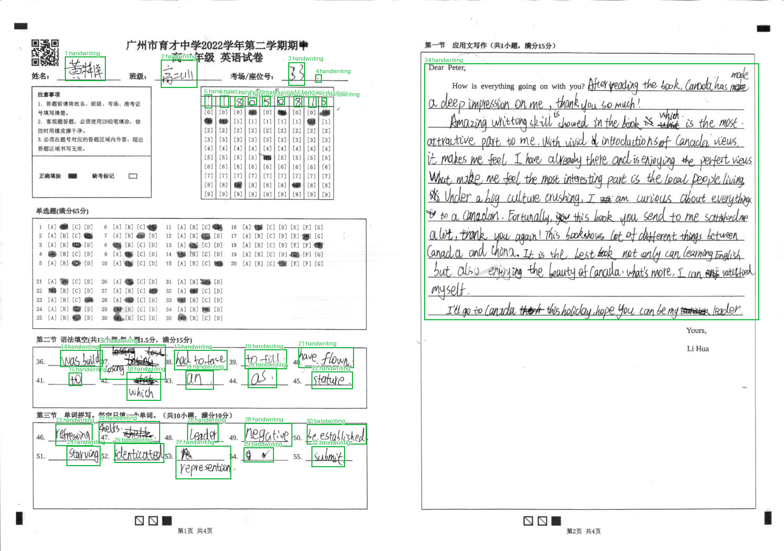
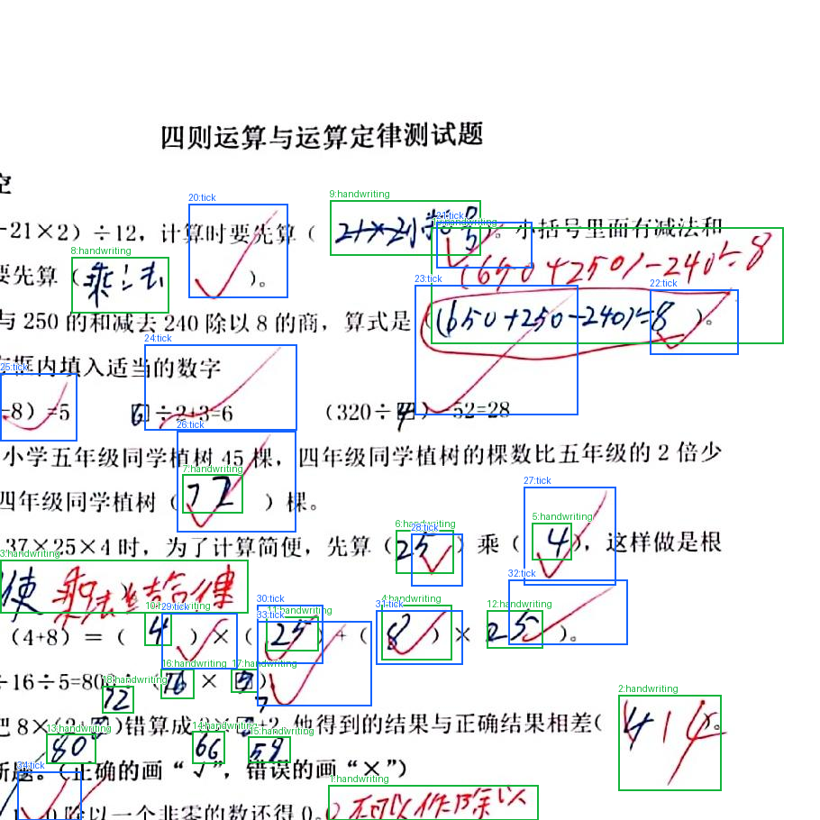
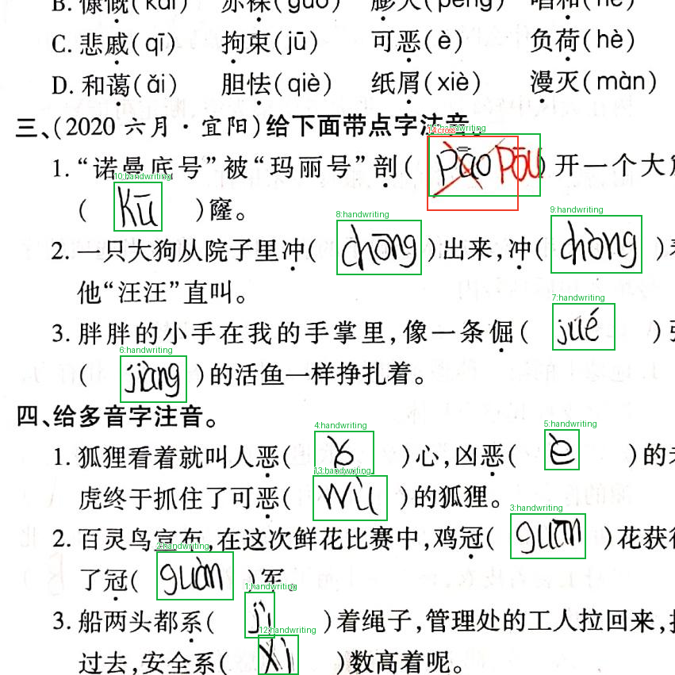
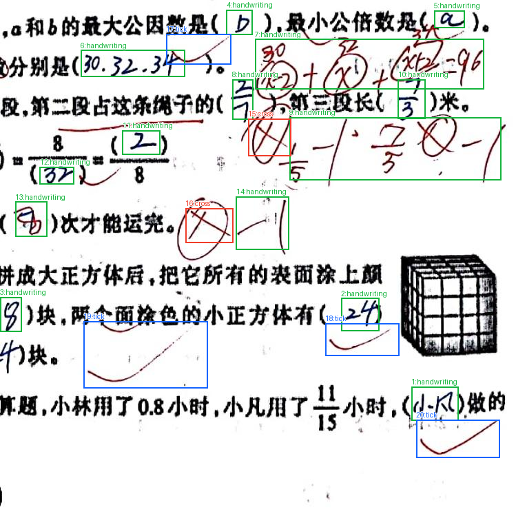
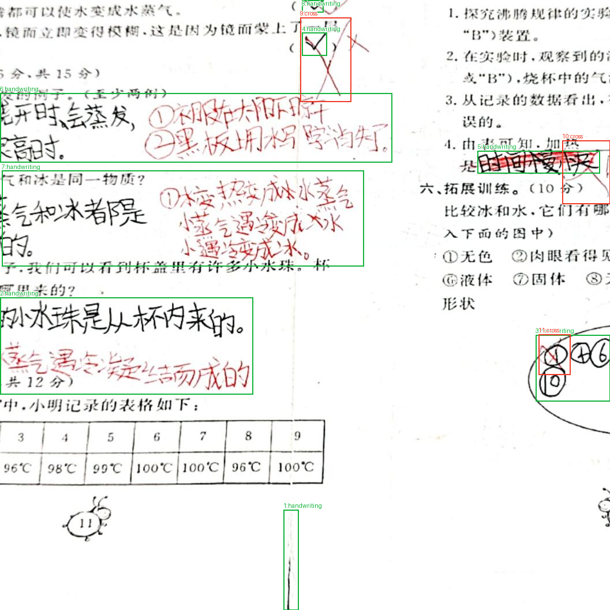
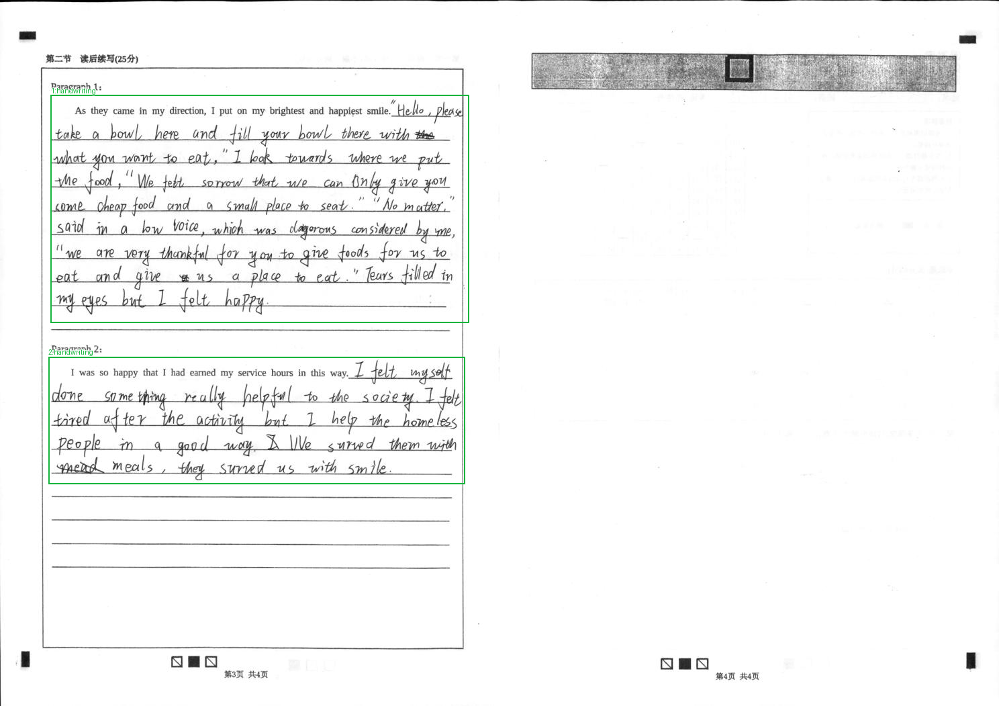
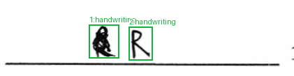
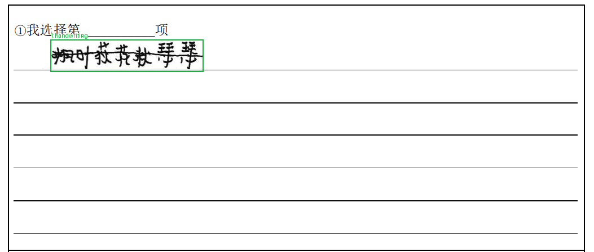

# 启辰数据集标注说明

在本任务中，同学们需要使用矩形框，标注图片中的手写体，勾勾、叉叉三个部分。三各类别的标签分别为 handwriting, tick, cross. 需要使用的标注软件为 `labelImg`. 该软件的使用说明可参阅 [labelImg.md](./labelImg.md).

## 总则

1. 只可以使用三个英文类别名，拼写必须完全一致：handwriting、tick、cross。
2. handwriting 标签用于标注手写区域。原图中的印刷字、印刷边框、印刷选项、答题卡填涂块和页码等不属于手写区域；tick 和 cross 标签分别用于标注教师批改的勾勾和叉叉。
3. 同一张图片建议分两遍标注：第一遍只标 handwriting，第二遍只标 tick 和 cross，最后再整图复核。不同类别的框允许相互重叠；不要为了“不重叠”而缩小或删掉某一类。
4. 标注时，不要把勾或叉再当作 handwriting 重复标注；但勾/叉压在答案上时，答案本身仍可另框为 handwriting。

## handwriting 类说明

1. handwriting 包括学生或教师手写的汉字、英文字母、单词、数字、小数、百分数、分数、算式、单位、答语、批注文字、姓名/班级/考号以及手写的数据标记。颜色不限，黑、蓝、红笔都算。
2. 通常来说，一个填空答案、一个选项字母、一个单词、一个算式、一段连续解题过程、一句答语、一处教师批注、一个姓名字段、一个考号字段，各为一个框。
3. 对于同一小题内连续书写的算式、计算过程、结论和“答：……”，如果属于同一作答区域且没有被其他印刷版面明显隔开，合并为一个 handwriting 框；不要按每一行或每一个数字拆成多个框。
4. 如果同一行有多个独立填空或彼此隔开的答案时，要分别框；不要跨过印刷题干把多个空合并。答题卡或表格中位于不同格子的数字/字符，按格分别框。
5. 同一词语或答案中彼此分开的笔画、偏旁、点、分数线、百分号、等号、小数点、单位等，只要语义上属于同一处书写，就合并进同一个框；明显属于两个不同空、两个不同字段或两处相隔较远的独立批注时，才分开。不要仅仅因为相邻就合并，也不要仅仅因为笔画不连就拆开。
6. 作文或续写：以每个独立作答区为实例。同一作答区连续多行的正文通常合成一个大的 handwriting 框，禁止按行切分。若版面用独立的段落标题或明显空白区域分成两个独立的写作任务，则每个任务各一个框；若作文为连续的一篇，即使内部有自然段，也只标注一个框。只框手写正文，版面上印刷的提示语、横线、页眉页脚和印刷署名不框。
7. 红色教师讲解、红色订正文字和红色算式仍属于 handwriting；不要把红笔文字全部排除。只有当红色笔迹是独立的勾或叉时，才归入 tick 或 cross。
8. 已经被划掉但仍可辨认的作答文字，仍框 handwriting；若其上另有明显的教师叉号，再单独框 cross。
9. 框应贴住可见笔迹：不要留大块空白，也不要把邻近印刷字包进来。印刷的答题横线、表格线和页边线尽量不纳入。
10. 被图片裁切的手写内容，只要还能看出是文字或数字，就保留并框到图像边界。

## tick 类说明

1. tick 是手写的批改勾号，通常呈一个短下折加一条较长上扬尾线，也可能较宽、较大，黑笔或红笔都可能出现。一个连续勾号一个框。
2. 不标注半勾。
3. 框要覆盖整个勾号的可见起笔、折点和尾端，包括穿过答案或印刷文字的长尾；不要只框折角，也不要因为尾线越过其他对象而截短。
4. 勾线若环抱或压在某个答案上，可以把被勾线直接环住的局部答案包含在 tick 框内；但不要把整段答案、整道题或相邻印刷题干整体框入。
5. 排除印刷的“√”符号、题干中的“正确画√”等印刷说明、普通括号、斜线、汉字笔画，以及只是像勾的汉字部件。
6. 勾与 handwriting 重叠时，两个框都可保留：答案文字归 handwriting，批改勾归 tick。不要把整条勾并入 handwriting，也不要把答案文字整体并入 tick。

## cross 类说明

1. cross 是手写的独立叉形批改符号，通常由两笔相交组成，用来标错或划掉答案；一个完整叉形一个框。
2. 框住叉号本体的可见范围，包括两臂末端；叉号覆盖在文字或算式中时，只框叉的主要笔画，不把整段被划文字都扩进 cross 框。
3. 叉与 handwriting 重叠时，两者可同时存在：被划但仍可辨认的答案/批注文字归 handwriting；独立叉形归 cross。若可见内容只有叉号、已看不出原文字，则只标 cross。
4. 排除：字母 x/X、数学乘法号 ×、手写公式中的变量 x、印刷的“×”或选项叉、题干说明中的叉号，以及学生用横线/圈划删除的文字。只有明显作为教师批改符号的独立叉才标 cross。
5. 不要把勾误标为 cross，也不要把 cross 误标为 tick。判断依据是整个符号形态：单勾、长勾为 tick；清楚的两笔相交叉为 cross。若一处同时有勾又有叉，应按可见的独立符号分别框。

## 整图检查顺序

1. 先缩放到整页，确认哪些是印刷版面、哪些是手写笔迹、哪些是批改符号；注意不要被已有印刷边框或答题卡网格误导。
2. 从上到下、从左到右扫一遍，先完成全部 handwriting。每框完成后检查：是否把一个完整答案拆碎、是否把多个空合并、是否把印刷字或填涂块框入、是否包含无关空白。
3. 再扫第二遍，只找 tick 和 cross；必要时放大，区分勾、叉、字母 x、乘号和印刷符号，并检查长尾是否完整、叉号是否只框本体。
4. 专门检查四个图像边缘：被裁切的手写、勾或叉要贴边保留；再检查页面中心的小数字、负号、小数点、分数线和极小批注。
5. 最后检查重叠关系：答案上确有勾或叉时是否两类都已标；是否把同一勾/叉重复标成多个实例；是否误留印刷文字、空白横线、答题卡填涂块、二维码、页眉页脚或黑色定位块。
6. 按三个类别分别复核总数量，再整体看一遍是否存在明显漏框或跨栏、跨题合并。

## 常见混淆的固定处理

1. 红色批改说明文字（如计算过程、订正句子）——handwriting；红色单独长勾——tick；红色独立叉——cross。
2. 学生选答字母 A/B/C/D 手写在括号中——handwriting；若教师在旁边打了勾，勾另框 tick。
3. 答题卡上机器判读的黑色方块或填涂块——不框；手写在格子内、仍可读的考号/姓名数字——handwriting。
4. 印刷的“√/×”与印刷题干——不框；手写覆盖在印刷内容上的字符——只框手写部分。
5. 同一答案区域有多行竖式或演算——通常一个 handwriting 框；但不同小题、不同填空或隔开很远的批注应分开。
6. 裁切处只剩一小段但形态可辨——贴边框；只是孤立墨点、污渍或无法判断内容的残片——不框。

## 标注实例

### 英语试卷答题卡

姓名、班级、考号和表格中的各个数字分别按字段/格子框；各填空题的答案分别成框，作文正文合成一个大框而不按行切分。印刷题干、答题卡黑色填涂块、空白横线和页边内容均未框，可作为排除印刷内容的依据。

### 数学-题卡合一

每个填空答案或算式是一个 handwriting 实例；红色教师订正文字仍归 handwriting。红色长勾全部单独标 tick，即使勾线穿过某个答案也不并入 handwriting，且勾的长尾完整保留。

### 语文-题卡合一

红色订正文字及算式用 handwriting 框；压在文字上的独立叉号另用 cross 框，两者允许重叠。画面下缘的手写内容框到图像边界，说明被裁切对象不能漏掉或缩回画面内。

### 填空作答与多行批注

填空题的每个答案分别成框，右侧连续的红色演算和批注按一个 handwriting 区域框；红勾为 tick、红色独立叉为 cross，二者不混类。可据此理解同题多行内容的合并与勾叉的分层。

### 教师讲解、叉号与边缘裁切

大段红色教师讲解文字属于 handwriting，而红色独立叉形符号属于 cross；叉号覆盖手写答案时两类框可同时存在。右侧贴近边缘的框说明对象被裁切时仍要框到图像边界。

### 独立段落作答区

两个独立标注的段落作答区各形成一个 handwriting 框，没有按每一行拆框；右侧空白页和印刷模板没有框。用于说明作文区域按独立作答块分组、禁止逐行标注。

### 相互分离的手写符号

两个相隔清楚空白的小手写符号分别成框，说明不能因为同处一条裁切图就强行合并成同一个 handwriting；同时框只贴笔迹，没有扩展到整条空白横线。

### 连续手写文字与印刷内容

连续手写的一串字合成一个 handwriting 框，未按单字拆开；印刷的题号、提示文字和空白横线均不框，可用于对照连续文字与印刷内容的边界。

