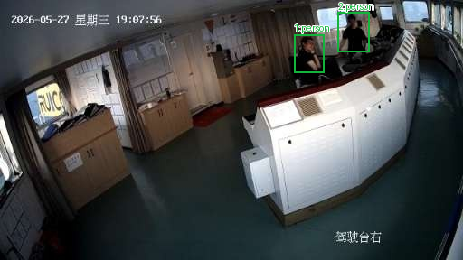
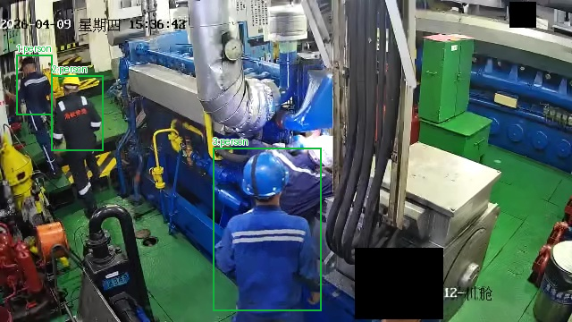
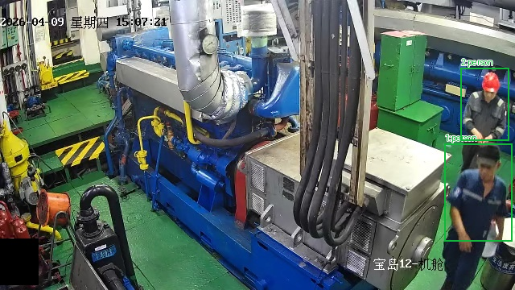
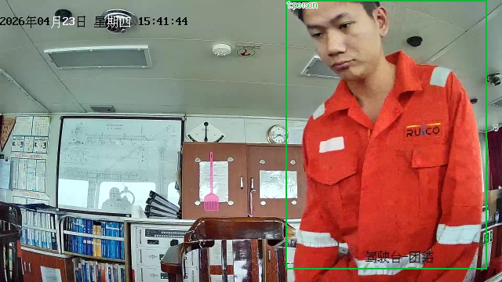
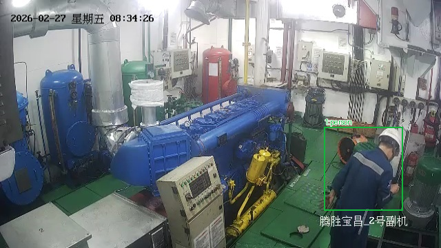
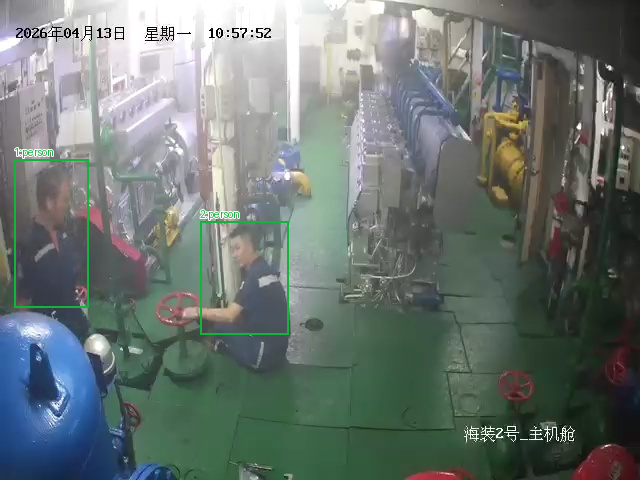
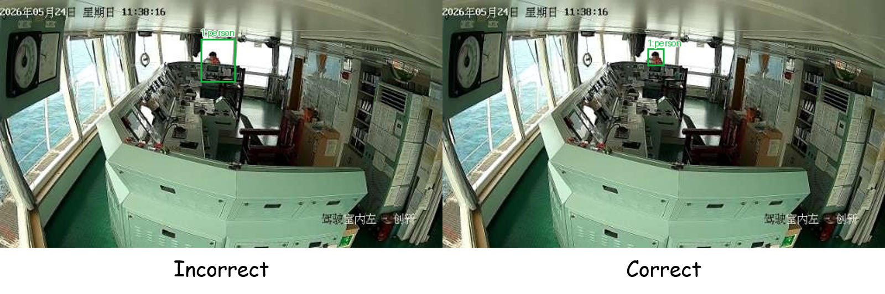
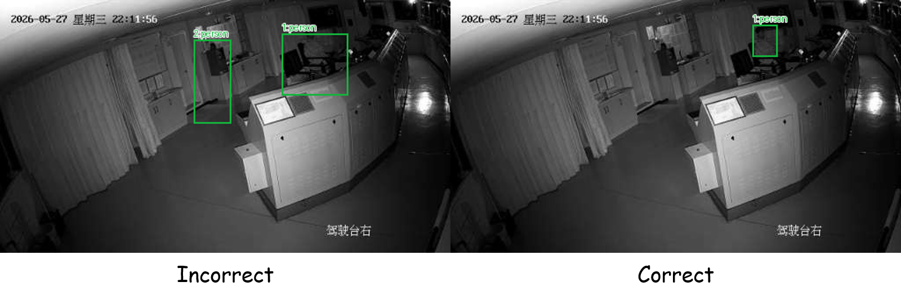

# 勤思数据集标注说明

在本任务中，同学们需要使用矩形框，标注图中的人体。同样使用 labelImg 进行标注。本数据集只需要标注 `person` 一个类别。

## 标注规则

**【标注目标】**只标注一个类别：`person`，即画面中真实存在的人（船员、驾驶员、轮机员、工作人员等）。

**【正例】**能辨认出头、躯干或身体的真人都要标：站立、坐着、蹲跪、弯腰、低头、背对镜头、正在操作设备、手持工具或纸张、穿工作服或便装、戴或不戴安全帽；夜间/黑白/逆光画面中的人；远处很小但可辨的人员；被设备、控制台、栏杆、桌子部分遮挡但能确认是人的实例；被画面边缘截断但仍可辨认的人。

**【反例】**不标照片、海报、证书、屏幕画面中的人像，不标人形图标、假人、镜面/玻璃倒影、挂在架子上的衣服、仅凭形状猜测的人体部件。监控画面已有的红色告警字、时间戳、船名/舱室文字、系统叠加框或原有告警框都不是 `person`；即使系统框套住了人，也不要照抄系统框，只按人体本身画框。设备、管线、绿色配电箱、控制台、椅背、阀轮、工具、纸张都不入框。

**【一实例一框】**每个人只给一个框，也不要给同一个人画两个近乎重复的框。两人靠近、一前一后、上下相邻或互相遮挡时，按各自可见的头肩和躯干分别成框，不要合并成一个大框，也不要把前一个人的框扩到后一个人。若某处只是同一人的手、头或衣物延伸，不要误当成第二个人另开框。

**【框边界】**框应贴住人体的“头部＋上半身”：上沿到头顶（含头发/安全帽），左右到肩、手臂和衣服外缘，**下沿到腰部**，腿部保留在框外。关键边界：人被控制台、机器、栏杆、桌子遮挡时，框止于遮挡处，不把遮挡设备框进去，也不向下或向两侧虚推被遮住的腿、脚；**全身完整可见时框下沿应至于腰部**。近景大面积人物不要只框脸，也不要把背后的设备、墙面扩进框内；远处小目标框可以很小，但仍应贴住其“头部＋上半身”，不要用大框圈住周围背景。

**【边缘与截断】**人从画面上、下、左、右出画时，对应边贴到 0、图像高度或宽度；未出画的一侧仍按“头部＋上半身”外缘收紧。例如头顶出画时上沿为 0，身体右侧贴边时右沿接近图像宽度。被截断的人仍算一个完整实例，不因出画放弃。

**【遮挡与相邻】**只露出头肩、半个身子、腿部的人，只要可确认是真实人员就标一个框；框覆盖可见部分，不沿设备边缘切掉人体，也不把遮挡物算作人体。两人一前一后或上下排列时分别给框，框可以重叠但不要互相套入。

**【整图检查顺序】**（1）先看画面中央、前景操作台和控制台后的人员；（2）再扫左右边缘、门口、走道远端、楼梯、机器之间和栏杆后的小目标；（3）检查两人紧邻或前后重叠处是否漏掉第二人、是否误合并；（4）检查被设备遮挡的人是否只框到可见身体、是否错误补画被遮住的腿；（5）最后复查海报人像、监控画面人像、告警文字、系统框、设备部件是否被误标，并删除重复框、缩小过大的框。上一轮低分主要来自框过大把设备并入、远处小人物漏标、以及给非人目标补框，复查时应重点修正。

## 标注实例

以下仅展示标注后的图片。前六个示例为教师标注正例，最后两个示例为模型的错误预测，仅用于说明常见错误，不能作为正确标注照抄。

### 控制台监控

控制台后两名人员各自一个紧框：框覆盖可见头肩和躯干，止于腰部/控制台遮挡处，不把台面、椅背或屏幕并入。相邻两人要分开成框。

### 远处小目标与前景工人

左侧远处两名穿工作服的小工人和前景蓝安全帽工人均有独立框：远处十几到几十像素高的人员不能漏，也不能把两名远处人员合并成一个大框；框紧贴人体的“头部＋上半身”，不圈入周围机器和管线。

### 纵向相邻的两名工人

画面右侧上、下两名工人纵向相邻，各自一个框，框虽接近但不合并。不把绿色设备或背景扩入框内。

### 近景人物截断与人像倒影排除

近景工人头顶被画面上边界截断，框上沿贴到 0；框覆盖人体的“头部＋上半身”，下部止于腰部。没有框到左侧墙面上的人体倒影或周围设备。说明大目标、上边界截断和人像倒影排除的处理。

### 弯腰工人的标注

工人弯腰、头部转向镜头，头与背部在画面中错开，仍只有一个框覆盖该实例；不要把错位的头、躯干拆成两个框，也不要把旁边的机器或地面并入。

### 存在设备遮挡时的两名工人标注

左侧和中间两名工人分别成框。框止于可见人体外缘/腰部。不把红色阀轮、蓝色罐体和控制箱并入。

### 反例：远处人物的框过大

反例：预测框把远处小人物周围的背景和控制台一起圈入，框远大于真实人体。正确处理是只保留紧贴远处坐姿人员头肩躯干的小框，小目标仍要标但框必须小。

### 反例：误标控制台与扩大人体框

反例：两个预测框，其中左侧框落在控制台/窗框区域，属于误框；右侧大框也把设备并入人体。该图只有一个真实人物，应只保留紧贴其头肩躯干的小框，不要给控制台、窗影或背景补框。

