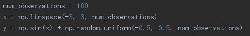

# 一、Numpy 基本操作（提交所有代码截图及运行结果）

1. 导入 numpy 库。
2. 建立一个一维数组 $a$，初始化为 $[4, 5, 6]$。
    - 输出 $a$ 的类型（type）。
    - 输出 $a$ 的各维度大小（shape）。
    - 输出 $a$ 的第一个元素。
3. 建立一个二维数组 $b$，初始化为 $[[4, 5, 6], [1, 2, 3]]$。
    - 输出 $b$ 的各维度大小（shape）。
    - 输出 $b[0, 0]$、$b[0, 1]$、$b[1, 1]$ 这三个元素。
4. 建立矩阵。
    - 建立一个大小为 $3 \times 3$ 的全 0 矩阵 $c$。
    - 建立一个大小为 $4 \times 5$ 的全 1 矩阵 $d$。
    - 建立一个大小为 $4 \times 4$ 的单位矩阵 $e$。
5. 建立一个数组 $f$，初始化为 $[0, 1, 2, 3, 4, 5, 6, 7, 8, 9, 10, 11]$（arange）。
    - 输出 $f$ 以及 $f$ 的各维度大小。
    - 将 $f$ 的 shape 改为 $3 \times 4$（reshape）。
    - 输出 $f$ 以及 $f$ 的各维度大小。
    - 输出 $f$ 的第二行（$f[1, :]$）。
    - 输出 $f$ 的最后两列（$f[:, 2:]$）。
    - 输出 $f$ 的第三行最后一个元素（使用 $-1$ 表示最后一个元素）。

# 二、熟悉深度学习框架 Pytorch/Tensorflow（提交每个练习的实现步骤描述以及下面要求提交的结果）

## 1、线性回归

1. 生成训练数据，数据为带有服从 $-0.5$ 到 $0.5$ 的均匀分布噪声的正弦函数，代码如下：

    

    画出这 100 个样本的散点图。**（提交散点图）**
2. 使用 Pytorch/Tensorflow 实现线性回归模型，训练参数 $w$ 和 $b$。

    $$
    y = w \cdot x + b
    $$

3. 输出参数 $w$、$b$ 和损失。**（提交运行结果）**
4. 画出预测回归曲线以及训练数据散点图，对比回归曲线和散点图并分析原因。**（提交图片及分析）**

## 2、线性回归（使用多项式函数对原始数据进行变换）

1. 生成训练数据，数据同上。
2. 使用 Pytorch/Tensorflow 实现线性回归模型，这里假设 $y$ 是 $x$ 的 3 次多项式，将数据扩展为 $x$、$x^2$、$x^3$ 三维数据，此时模型变为：

    $$
    y = w_1 \cdot x + w_2 \cdot x^2 + w_3 \cdot x^3 + b
    $$

3. 训练模型并输出参数 $w_1$、$w_2$、$w_3$、$b$ 和损失。**（提交运行结果）**
4. 画出预测回归曲线以及训练数据散点图，对比回归曲线和散点图并分析原因。**（提交图片及分析）**

## 3、Softmax 分类

1. 获取 MNIST 数据集，每张图片像素为 $28 \times 28$。
2. 模型架构为：

    $$
    y = \operatorname{softmax}(w \cdot x + b)
    $$

    其中 $w$ 的维度为 $784 \times 10$，$b$ 的维度为 $10$。
3. 画出训练和测试过程的准确率随迭代次数变化图，画出训练和测试过程的损失随迭代次数变化图。**（提交最终分类精度、分类损失以及两张变化图）**

# 提交说明

1. 请提交 `docx` 文件。如果使用 Markdown 编写，请先用 [Pandoc](https://pandoc.org/) 转换为上述格式。
2. 文件名应为 `序号-班级-学号-姓名-exp1-v版本号.后缀`，其中：
    - `序号` 为 `华南理工大学教学班点名册` 中对应列的值。
    - `班级` 必须与 `华南理工大学教学班点名册` 中的名称完全一致。例如，应填写 `23计算机科学与技术1班`，不要简写为 `23计科1班`。
    - `学号` 必须是 12 位。
    - `版本号` 必须是大于 0 的有效十进制整数，前面加字母 `v`，例如 `v1` 或 `v2`。
    - `后缀` 只能是 `docx`，不要重复添加后缀，例如 `xxx.docx.docx`。
    - 示例：`1-23计算机科学与技术1班-202330459999-张三-exp1-v1.docx`。
3. 如需重新提交，请依次递增版本号（如 `v2`、`v3`）。每位同学最多可提交 3 个版本，最终以最后提交的版本为准。
4. 文件名不符合上述格式或超过截止时间提交的文件，均不予接收。截止时间为 2026 年 10 月 11 日 23:59。
5. 请通过 `http://222.201.139.67:8080/files/exp1/` 提交文件，登录用户名为 `student`，密码为 `123456`。不接受通过 QQ 等其他方式提交。
6. 提交前请检查文档排版，确保格式整洁、便于批阅。
