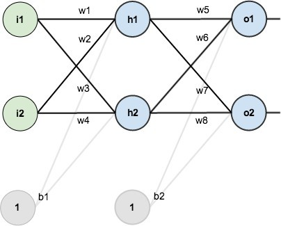
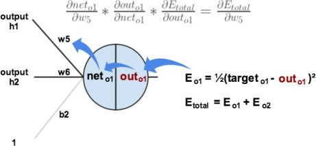

# 一、多层感知机用于 MNIST 手写数字数据集分类（提交实现步骤描述以及下面要求提交的结果）

1. 获取 MNIST 数据集，每张图片像素为 28 × 28。
2. 模型架构为包含两个隐含层的多层感知机模型。
    - 输入层维度：$28 \times 28 = 784$
    - 第一层隐含单元数：256
    - 第二层隐含单元数：256
    - 输出层维度：10（MNIST 数据集类别数，分别为 0 到 9）
3. 画出训练和测试过程的准确率随迭代次数变化图，画出训练和测试过程的损失随迭代次数变化图。**（提交最终分类精度、分类损失以及两张变化图）**

# 二、卷积神经网络用于 MNIST 手写数字数据集分类（提交实现步骤描述以及下面要求提交的结果）

1. 获取 MNIST 数据集，每张图片像素为 28 × 28。
2. 模型架构：
    - 输入层维度：$28 \times 28$
    - 卷积层和池化层的 padding 均使用“SAME”。
    - 卷积层 1：卷积核大小为 $5 \times 5$，卷积核个数为 32（输出维度为 $28 \times 28 \times 32$）。
    - 池化层 1：使用最大池化，核大小为 $2 \times 2$，stride 为 2（输出维度为 $14 \times 14 \times 32$）。
    - 卷积层 2：卷积核大小为 $5 \times 5$，卷积核个数为 64（输出维度为 $14 \times 14 \times 64$）。
    - 池化层 2：使用最大池化，核大小为 $2 \times 2$，stride 为 2（输出维度为 $7 \times 7 \times 64$）。
    - 将池化层 2 的输出展平作为全连接层的输入，输入维度为 $7 \times 7 \times 64 = 3136$。
    - 全连接层：隐含单元数为 1024。
    - Dropout 层：Dropout 率为 0.25。
    - 输出层维度：10（MNIST 数据集类别数，分别为 0 到 9）。
3. 画出训练和测试过程的准确率随迭代次数变化图，画出训练和测试过程的损失随迭代次数变化图。**（提交最终分类精度、分类损失以及两张变化图）**

# 三、多层感知机实现异或运算（提交实现步骤描述、源代码以及最后的测试误差）


要求：**不允许使用 Pytorch/Tensorflow 等深度学习框架**，使用 Python 实现网络的前向传播和反向传播过程。源代码文件命名为 “main.py”。

数据集：

```text
[[[0, 0], [0]],
    [[0, 1], [1]],
    [[1, 0], [1]],
    [[1, 1], [0]]]
```

**BP 算法实现**



**可供参考的实现过程：**

**单个神经元操作：**
1. 定义参数矩阵、定义激活函数、定义损失函数。
2. 计算神经元输出。
3. 计算误差。



**实现前向传播：**
1. 定义神经元个数。
2. 计算层中每个神经元的输出。

**实现反向传播：**
1. 计算误差。
2. 计算每一层中权重的梯度。
3. 更新输出层权重。
4. 更新隐含层权重。


# 提交说明

1. 每位同学需提交一个 ZIP 压缩包，包含以下文件：
    - `序号-班级-学号-姓名.docx`：实验报告，需包含以下内容：
        - **多层感知机用于 MNIST 手写数字数据集分类**：实现步骤、最终分类精度、分类损失以及两张变化图。
        - **卷积神经网络用于 MNIST 手写数字数据集分类**：实现步骤、最终分类精度、分类损失以及两张变化图。
        - **多层感知机实现异或运算**：实现步骤和最终测试误差。
    - `main.py`：多层感知机实现异或运算的源代码。源代码仅需提交该 Python 文件，请勿将虚拟环境打包。
2. 压缩包应为 `序号-班级-学号-姓名-exp2-v版本号.后缀`，其中：
    - `序号` 为 `华南理工大学教学班点名册` 中对应列的值。
    - `班级` 必须与 `华南理工大学教学班点名册` 中的名称完全一致。例如，应填写 `23计算机科学与技术1班`，不要简写为 `23计科1班`。
    - `学号` 必须是 12 位。
    - `版本号` 必须是大于 0 的有效十进制整数，前面加字母 `v`，例如 `v1` 或 `v2`。
    - `后缀` 只能是 `zip`，不要重复添加后缀，例如 `xxx.zip.zip`。
   - 命名示例：`1-23计算机科学与技术1班-202330459999-张三-exp2-v1.zip`。
3. 如需重新提交，请依次递增版本号（如 `v2`、`v3`）。每位同学最多可提交 3 个版本，最终以最后提交的版本为准。
4. 文件名不符合上述格式或超过截止时间提交的文件，均不予接收。截止时间为 **2026 年 10 月 18 日 23:59**。
5. 请通过 `http://222.201.139.67:8080/files/exp2/` 提交文件，登录用户名为 `student`，密码为 `123456`。不接受通过 QQ 等其他方式提交。
6. 提交前，请检查实验报告的排版，确保格式整洁、便于批阅，并核对压缩包中的文件是否符合提交要求。实验报告的排版质量及提交文件是否符合要求，均可能影响本次作业的成绩。
7. 压缩包大小不得超过 **10 MB**，超出限制的文件将被自动删除。如有特殊情况，请联系助教。
