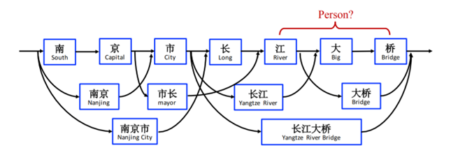
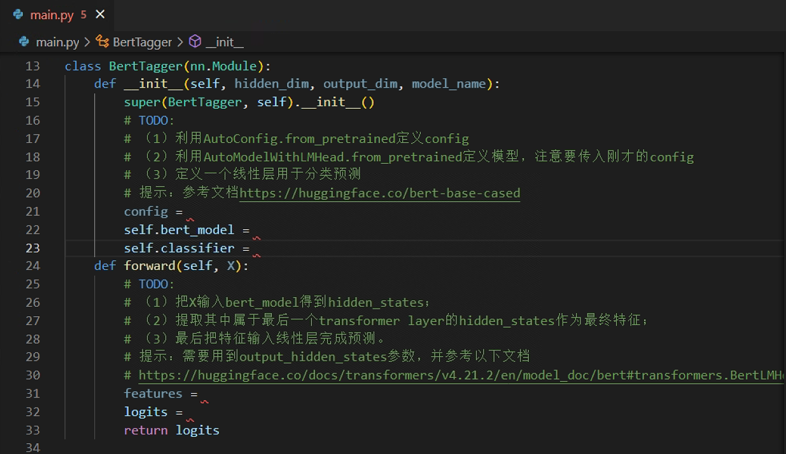

# 一、变分自编码器生成 MNIST 手写数字（结合代码描述实现步骤以及提交下面要求提交的结果）

推荐使用高斯分布随机初始化模型参数，可以避免一部分模式坍塌问题。

模型架构：

1. 编码器（全连接层）：输入图片维度：784（28 × 28）；输出层维度（ReLU）：400。
2. 生成均值（全连接层）：输入层维度：400；输出层维度：20。
3. 生成标准差（全连接层）：输入层维度：400；输出层维度：20。
4. 使用均值和标准差生成隐变量 z。
5. 解码器（全连接层）：输入维度：20；隐藏层维度（ReLU）：400；输出层维度（Sigmoid）：784。

训练完网络，需要提交重构损失和 KL 散度随迭代次数的变化图，以及 10 张生成的手写数字图片。

# 二、使用 Transformer 解决命名实体识别（Named Entity Recognition）任务

## 任务

命名实体识别（Named Entity Recognition，简称 NER）是自然语言处理领域的基础任务之一，是指识别文本中具有特定意义的实体，主要包括人名、地名、机构名、专有名词等。下图举了一个 NER 的例子，对人类来说识别出“南京市”和“长江大桥”是比较简单的任务，但是对模型来说却有可能识别出错误的实体。

## 模型

近年来，以 Transformer 为基础的深度学习模型在自然语言处理和视觉领域盛行。此次作业旨在熟悉 Transformer 的原理及调用。推荐使用 Python 库 transformers 来载入以及训练一个 transformers 模型。具体的模型采用 bert-base-cased 作为编码器，全连接层用于分类。

## 数据集

使用的数据集为 CoNLL2003。CoNLL2003 共包含 4 种实体类别，分别是 location（地点名）、organization（组织名）、person（人名）和 miscellaneous（杂项）。此外，不属于任何实体类别的单词应该被标注为 O（其他）。以下为示例：

示例输入：`Japan began the defence of their Asian Cup title with a lucky 2-1 win against Syria in a Group C championship match on Friday`

真实标签：`B-location O O O O O B-misc I-misc O O O O O O O B-location O O O O O O O O O`

说明：实体类别前的 B-/I- 表示 Begin 和 Inside，实体的第一个词应该以 B- 开头，实体后面的词应该以 I- 开头。例如 Asian Cup 的 Asian 标注为 B-misc，Cup 则标注为 I-misc。

## 任务说明：

1. 阅读提供的代码，补充 TODO 位置的代码。

   

2. 利用 main.py 训练一个 NER 模型，记录并可视化训练过程，比如 loss、f1。

3. 训练结束后，利用 predict.py 载入保存的模型，并输入自定义的例子进行预测，分析模型的输出结果。

4. 回答思考题：
   1. CoNLL2003 有 4 种实体类型，为什么输出的维度是 9；
   2. 为什么需要额外加线性层用于预测，而不用 transformers 模型原有自带的线性层；
   3. 在 predict.py 当中，tokenizer 的作用是什么；
   4. 在 predict.py 当中，mask 的作用是什么。

5. 扩展（选做）：说明现有模型不足之处并改进模型，展示改进模型的性能。比如，增加 CRF 层。

# 提交说明

1. 每位同学需提交一个 ZIP 压缩包，包含以下文件：
    - `序号-班级-学号-姓名.docx`：实验报告，需包含以下内容：
        - **变分自编码器生成 MNIST 手写数字**：实现步骤、重构损失和 KL 散度的变化图、10 张生成的手写数字图片。
        - **命名实体识别**：实现步骤、关键代码、训练过程的可视化结果（比如 loss、f1）、思考题、扩展任务（选做）。
    - `vae.py`：**变分自编码器生成 MNIST 手写数字** 对应的代码。
    - `main.py`：NER 实验对应的 `mian.py` 文件。
2. 压缩包应为 `序号-班级-学号-姓名-exp3-v版本号.后缀`，其中：
    - `序号` 为 `华南理工大学教学班点名册` 中对应列的值。
    - `班级` 必须与 `华南理工大学教学班点名册` 中的名称完全一致。例如，应填写 `23计算机科学与技术1班`，不要简写为 `23计科1班`。
    - `学号` 必须是 12 位。
    - `版本号` 必须是大于 0 的有效十进制整数，前面加字母 `v`，例如 `v1` 或 `v2`。
    - `后缀` 只能是 `zip`，不要重复添加后缀，例如 `xxx.zip.zip`。
   - 命名示例：`1-23计算机科学与技术1班-202330459999-张三-exp3-v1.zip`。
3. 如需重新提交，请依次递增版本号（如 `v2`、`v3`）。每位同学最多可提交 3 个版本，最终以最后提交的版本为准。
4. 文件名不符合上述格式或超过截止时间提交的文件，均不予接收。截止时间为 **2026 年 10 月 25 日 23:59**。
5. 请通过 `http://222.201.139.67:8080/files/exp3/` 提交文件，登录用户名为 `student`，密码为 `123456`。不接受通过 QQ 等其他方式提交。
6. 提交前，请检查实验报告的排版，确保格式整洁、便于批阅，并核对压缩包中的文件是否符合提交要求。实验报告的排版质量及提交文件是否符合要求，均可能影响本次作业的成绩。
7. 压缩包大小不得超过 **10 MB**，超出限制的文件将被自动删除。如有特殊情况，请联系助教。